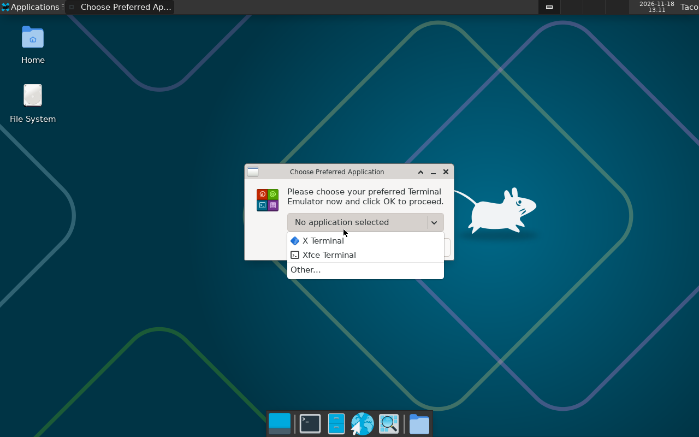
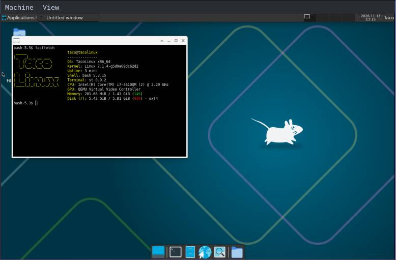

# tacolinux

the worlds worst distro of linux.

> [!WARNING]
> TacoLinux isn't a joke. it needs real Linux exp. do not use it as a first distro.
---------

## show off



*XFCE desktop session on TacoLinux (booted in QEMU).*



*XFCE with `st` open and `fastfetch` showing off the system.*

---------

## install

tacolinux is not like normal distros.  
you need to know how to build and package a root file system into a drive  
or dd the image we provide to a drive (this erases all data on disk)  

be sure to run  

```sh
lsblk
```

to see devices you have OR  

```sh
fdisk -l
```

Both should work.  

### formating the drive

to format a drive and prepare it for install we recommend fdisk.  
also a reminder:
Do not use the tacolinux setup image TO install tacolinux.
it wont work. most utils are not install by default.

i recommend using the cfdisk util.  

```sh
cfdisk /dev/DEV
```

replace DEV with device name shown to you in lsblk or fdisk -l.  
MOST importently. USE THE GPT LAYOUT!  

make a partition layout like this on a 50GB disk:  

| Partition | Size | Type |
| ----------- | ------- | -------- |
| /dev/DEV1 | 40GB | Linux |
| /dev/DEV2 | 9GB | Linux Swap |
| /dev/DEV3 | 1GB | Linux |
| /dev/DEV4 | 2MiB | BIOS boot |

here is an explanation of the layout.  

- /dev/DEV1 - Meant to be the root storage of distro  
- /dev/DEV2 - Meant to be the Swap of distro  
- /dev/DEV3 - Meant to be the Uefi or Bios /boot partition storing all of the files needed for boot
- /dev/DEV4 - grub boot partition Meant to be for booting on Bios systems.

> [!IMPORTANT]
> In `cfdisk`, set the type of ``/dev/DEV4`` to **BIOS boot** (partition type
> code ``EF02``), not "Linux". GRUB's ``i386-pc`` target embeds ``core.img``
> into this partition on a GPT disk, and it will not boot without it.
> Do **not** run ``mkfs`` on ``/dev/DEV4`` — it holds raw GRUB data, not a
> filesystem.

Now we need to format a filesystem for them.  

```sh
mkfs.ext4 /dev/DEV1
mkswap /dev/DEV2
mkfs.vfat -F32 /dev/DEV3
```

after this should be ready for the next step.

### installing the distro Rootfs

first for this step you need a machine connected to the internet and it should  
have the util named ``git`` we need it to clone the repo.  

first run

```sh
mkdir /mnt/prep
mount /dev/DEV1 /mnt/prep
mkdir /mnt/prep/boot
swapon /dev/DEV2
mount /dev/DEV3 /mnt/prep/boot
```

this preps ``/mnt/prep`` for installation.  
then do. on the dir you are in.  

```sh
git clone https://github.com/taco-pepe/TacoLinux
cd TacoLinux
```

this operation will take a bit of time depending on network speed.  
once its done do:  

```sh
cp bootstrap/grubstrap.py .
python3 grubstrap.py
```

this is the main setup. you should see:  

```shout
Root partition: 
```

enter in the root partition. (/dev/DEV1)  

after that you should see:  

```
Boot partition: 
```

enter in the boot part (/dev/DEV3)

after that:

```
Swap partition: 
```

enter in the swap partition (/dev/DEV2)

after that:

```
Target disk (e.g. /dev/sda): 
```

enter in the Target disk for grub to be installed to (/dev/DEV4)

after this the script will do its job setting up the env for boot.

---------

## desktop sessions

**TacoLinux is a dwm distro.**  `dwm` is the default session: it is what SDDM
selects for you, and it is the hand-built window manager this whole thing
exists for.  XFCE is installed next to it as a normal desktop for when you
want one -- it is not the point of the distro.

SDDM is the display manager.  Both sessions live in `usr/share/xsessions/`:

| Session | File | Notes |
| --- | --- | --- |
| `dwm` | `usr/share/xsessions/dwm.desktop` | default |
| `xfce` | `usr/share/xsessions/xfce.desktop` | from nixpkgs |

Switch just for one login from the session menu in the greeter.  SDDM has no
"default session" setting, so the default comes from `state.conf`: the image
seeds `/var/lib/sddm/state.conf` with `[Last] Session=dwm.desktop`, and
`RememberLastSession` (on by default) keeps whatever a user picks.  To change
the default for a fresh install, change that line to `xfce.desktop` -- note
the file name, not the `Name=` field.

SDDM and XFCE come from nixpkgs and are installed into a **separate** Nix
profile, `/nix/var/nix/profiles/desktop`.  The bundled Nix default profile is
left alone, so more window managers or desktops can be added the same way
without disturbing the base system.

---------

## bundled cli tools

`rootfs/usr/local/bin` ships a baseline of everyday CLI tools — `nano`
included. Every one of them is a **fully static (musl) binary**, and that is
deliberate: TacoLinux keeps its libc in `/nix/store`, so a normal dynamically
linked binary from another distro has nothing to link against (this is exactly
how XBPS managed to segfault the whole system by hauling in a Void `glibc`).
Static binaries need no libc at all, so they run on the base system, in a
chroot, or in a future rootfs without ever touching `/nix`.

The sources are vendored in `sources/` (any `.git` removed) and the build is
reproducible:

```sh
./scripts/fetch-cli-sources.sh   # download/extract into sources/
./scripts/build-cli-tools.sh     # podman + alpine -> rootfs/usr/local/bin
./scripts/test-cli-tools.sh      # assert every binary is static and runs
```

`scripts/cli-tools/apps.tsv` is the manifest (name, version, source URL,
recipe). Adding a tool means one line there plus a `b_<name>()` recipe in
`scripts/cli-tools/build-inner.sh`. Only ELF files without a `PT_INTERP`
segment are harvested, so a dynamic build can never silently ship.

Included (41 projects, 84 binaries): `nano` · `mg` · `less` · `links` · `tree` ·
`ncdu` · `fdupes` · `file` · `patch` · `dos2unix`/`unix2dos`/`unix2mac` ·
`jq` · `jo` · `pv` · `bc`/`dc` · `units` · `zstd` · `lz4` · `bzip2` · `unzip` ·
`procps` (`ps`, `top`, `free`, `vmstat`, `watch`, `kill`, `pgrep`, `pkill`,
`pmap`, `slabtop`, `sysctl`, …) · `psmisc` (`killall`, `pstree`, `fuser`,
`prtstat`) · `strace` · `lsof` · `hdparm` · `pciutils` (`lspci`, `setpci`,
`pcilmr`) · `ethtool` · `wget` · `tcpdump` · `mtr` · `iftop` · `sshpass` ·
`net-tools` (`ifconfig`, `netstat`, `route`) · `socat` · `tmux` · `screen` ·
`dialog` · `entr` · `moreutils`.

`links` works in both modes from the same static binary: plain `links` is the
TUI browser, and `links -g` opens the graphical browser on an X display (it
draws with Links' built-in font, so it needs no runtime data files).

Aliases (`unzstd`, `zstdcat`, `bunzip2`, `bzcat`, `zstdmt`) are plain symlinks
next to the real binary. Licences stay upstream's; the sources are kept here
so GPL binaries ship with their corresponding source.

---------

## prebuilt images

There are two steps.  First install the desktop closure into `rootfs/` -- it
is a ~2 GiB download the first time, and it is deliberately **not** committed
to git:

```sh
sudo ./scripts/build-desktop.sh
```

The build is capped to 6 cores / 6 GiB by default, which is friendlier on a
laptop.  Set `CAP=0` to let it use the whole machine:

```sh
sudo CAP=0 ./scripts/build-desktop.sh
```

Then pack the whole `rootfs/` (base system + desktop closure) into a bootable
disk.  This needs root for loop devices and mount:

```sh
sudo ./scripts/build-vm-image.sh

# useful knobs
sudo ROOTFS=./rootfs IMG_SIZE=8G COMPRESS=zstd ./scripts/build-vm-image.sh
```

Outputs land in `dist/`:

| File | Use |
| --- | --- |
| `tacolinux-<ver>-x86_64.qcow2` | run it directly in QEMU/KVM (manual builds only) |
| `tacolinux-<ver>-x86_64.img.zst` | `zstd -dc <file> \| sudo dd of=/dev/sdX bs=4M status=progress` (manual builds) |
| `tacolinux-<ver>-x86_64.img.xz` | `xz -dc <file> \| sudo dd of=/dev/sdX bs=4M status=progress conv=fsync` (tag releases) |
| `SHA256SUMS` | verify the downloads |

Tag builds (`v*`) are tuned for downloading: they use `COMPRESS=xz` (`xz -9e`,
the smallest and slowest mode) and `QCOW2=0`, so a release contains only the
compressed raw image and `SHA256SUMS` -- no multi-gigabyte qcow2.  Local and
manual builds keep the faster zstd + qcow2 defaults.

Run an image without touching it (a qcow2 overlay is created automatically):

```sh
./scripts/startvm.sh dist/tacolinux-<ver>-x86_64.img
# then, from the host:
ssh -p 2222 taco@localhost
```

`DISPLAY_BACKEND=none` boots headless, and `SSH_PORT`, `MEM` and `SMP` are
overridable (`SSH_PORT=2223 ./scripts/startvm.sh …`).  The base `dist/*.img`
is never modified.

Disk layout (GPT):

| Partition | Size | Contents |
| --- | --- | --- |
| `p1` | 2 MiB | BIOS boot: raw GRUB `core.img`, no filesystem, never `mkfs` it |
| `p2` | rest | ext4 root, including `/boot` with `bzImage` and `initramfs.img` |

GRUB is installed to the *disk* (`--target=i386-pc`), with
`--boot-directory` pointing at `<root>/boot`. No swap partition is created;
add one or use zram if you want swap.

CI: `.github/workflows/build-image.yml` builds on `v*` tags (and manually) and
attaches the images plus `SHA256SUMS` to the GitHub release. Builds run
`scripts/build-xbps.sh` so images ship **XBPS alongside Nix**. Tag builds also
run `build-desktop.sh`, so tagged images include SDDM + XFCE; a manual run can
opt out of the desktop closure. GitHub caps release assets at 2 GiB, so larger
files are split into `.partNN` chunks; put them back together with
`cat name.part* > name` and verify with `sha256sum -c SHA256SUMS`. The Forgejo
mirror has the same workflow in `.forgejo/workflows/build-image.yml`, but it
needs a self-hosted runner with loop/mount privileges: Codeberg's hosted
runners are containers and cannot do this.

### why not .qcow / .qcow2.gz / .img.gz?

- `.qcow` is QEMU's ancient v1 format. qcow2 is what every tool reads today.
- compressing qcow2 throws away sparse clusters and random access, which is the
  whole point of qcow2. It is already sparse; ship it as-is.
- gzip is slower and compresses worse than zstd on disk images. `COMPRESS=xz`
  (smaller, slower) and `COMPRESS=gzip` (compatibility) are still available.

